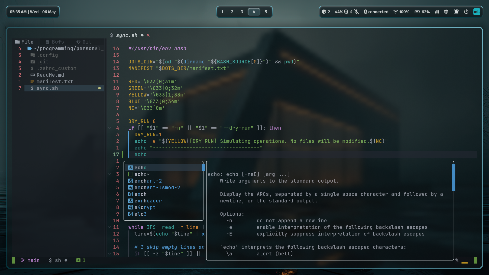
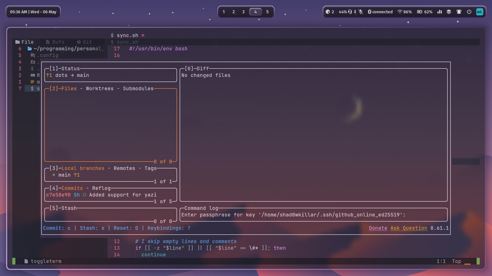
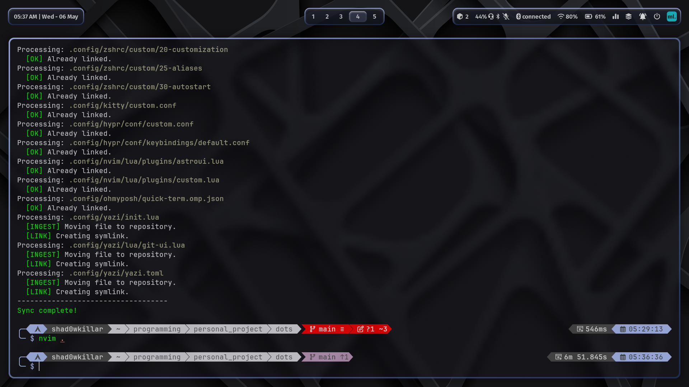
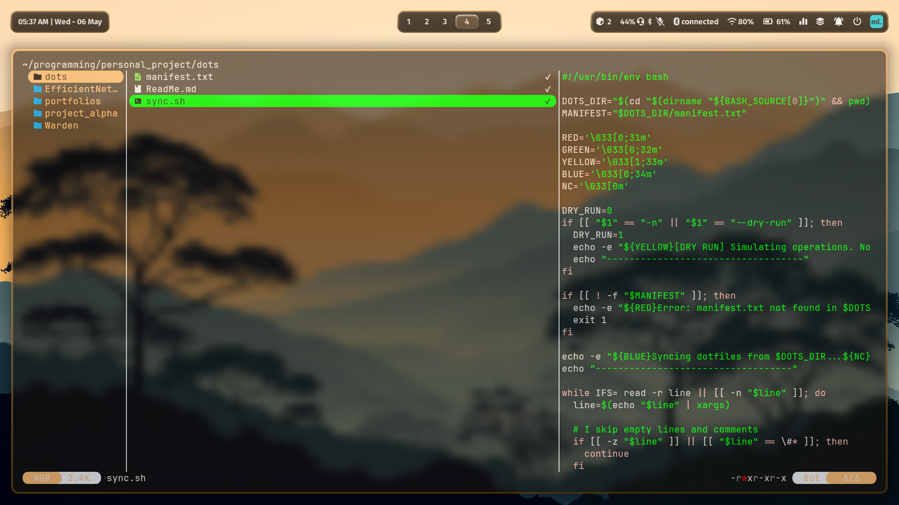

# Shad0wKillar's Arch System Dotfiles

This repository contains the custom configuration files for my Arch Linux system. It is specifically designed to sit on top of the **ML4W (MyLinuxForWork)** base system without interfering with its default symlink management. 

The tracking and deployment of these files are handled by a custom **Manifest-Driven Symlink System** rather than standard tools like GNU Stow, ensuring safe, conflict-free integration.

---

## Screenshots





## Hardware & Software Stack

These configurations were built and tested on a Dell Latitude 5490 (LightBox) with an i5 8th gen processor and an Nvidia MX130. 

### Restore the configuration

Install ML4W's Lua-based Hyprland configuration and the AstroNvim v6 template first. Clone this repository, then run the following from the checkout.

```sh
./sync.sh --dry-run
./sync.sh
```

The [manifest](manifest.txt) lists the active paths relative to your home directory. Older Hyprland, Zsh and Yazi files outside the manifest are retained for review. Sync leaves them alone.

Most entries link directly to this checkout. For six files that mix ML4W code with personal edits, the [patches](patches) directory holds just the differences. Sync checks the installed file, applies a matching patch to a private copy and links that copy into place. On an incompatible base it reports the path during preflight. After an ML4W update, rerun the dry run and sync to restore any replaced links.

Edit personal files through their links as usual. For a patched file, keep permanent edits in its patch. The linked merged copy lives under `$XDG_STATE_HOME/dots` (normally `~/.local/state/dots`). Keep this directory and the checkout while using the links. Each sync that replaces a file prints the backup directory containing the originals under their home-relative paths. Selecting Waybar also archives ML4W’s empty `waybar-disabled` marker if present.

### Machine-specific dependencies

- The display profile recognizes the Dell P2419H by its description. The laptop display uses 1.2 scaling.
- The Hyprland bindings reference T3 Code and the local Kotodama checkout, including its Python virtual environment. The Zen launcher expects the browser under `~/.local/opt/zen-browser`. The wallpaper folder setting points to `~/Pictures/wallpaper/ml4w_wallpapers`.
- The Zsh prompt uses Oh My Posh and the ML4W Zsh override in `~/.config/zshrc/custom/20-customization`. The Neovim language packs are selected in `~/.config/nvim/lua/community.lua`.
- Sync installs user unit files. The wallpaper helper starts its service on demand. KWallet login unlock also depends on the machine’s PAM configuration. Unit enablement and system-wide configuration are managed separately.
